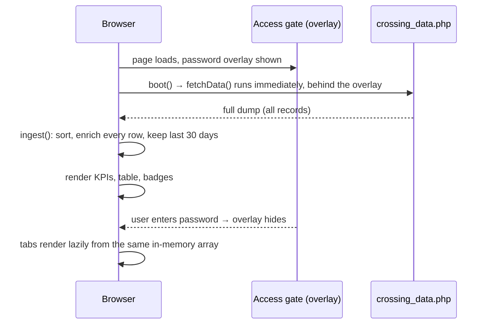

# Crossing data: current workflow and proposed APIs

This covers the reference dashboard in `bbai/index.html` (the Blue-Bird "BB Toll v3" build for the Nagpur / Champa plaza):

- **Part 1** describes how that dashboard gets and uses crossing data today.
- **Part 2** lists the APIs that replace it. They split the same data into paginated lists and separate stats endpoints, all served from the database.

Line numbers refer to `bbai/index.html`.

---

## Part 1 · How the reference dashboard works today

### 1.1 One endpoint, one full dump

All crossing data comes from a single request (`fetchData()`, line 16436):

```
GET https://alerts-us.blue-bird.ai/nagpur/crossing_data.php?token=<static token>
→ { "status": "success", "count": <n>, "data": [ <crossing>, ... ] }
```

- **No filters or pages:** the endpoint takes no filter, date or page parameters. It returns every record it holds. The code comments mention about 66,000 records (lines 15961–15963).
- **Images and clips:** these come from a separate path, `https://alerts-us.blue-bird.ai/nagpur/uploads/rgHwgyZwe/<image_url>`. `video_url` uses the same base unless it's already an absolute URL (lines 24085, 24277).
- **Other requests:** the page makes two more, and neither is crossing data. One goes to `ipapi.co` and one to `formsubmit.co`, both for login logging (see 1.6).

### 1.2 Boot sequence



1. **Page load (`boot()`, line 22239):** wires the UI and calls `fetchData()` straight away. The data is fetched **while the password overlay is still showing**. The overlay hides the dashboard but doesn't stop the download.
2. **`ingest()`, lines 16497 and 24706:**
   - **Windowing:** the whole payload is parked in memory, but only the **last 30 days** are processed when there are more than 5,000 records (the "v26 windowed boot").
   - **Enrichment:** each kept row is sorted newest first and gets derived fields:
     - `_ts`: epoch milliseconds
     - `_alerts`: fraud alerts computed in the browser (see 1.4)
     - `_alertScore`, `_alertLoss`
     - `_search`: one lowercase text blob for the search box
     - `_isNew`: whether the row appeared since the last fetch
     - `_wl`: a watchlist match, added later
3. **First render:** the KPI strip, the virtualized crossings table and the tab badges.
4. **Refresh:** a full re-fetch of the whole dump, via the Refresh button or the `R` key. `POLL_MS = 15000` is declared but nothing uses it, so there's no automatic polling. Rows that weren't in the previous fetch get a "new" highlight and count towards the "N new" pill.
5. **"All" time range:** the parked records older than 30 days are processed on demand (`v26LoadFullHistory()`, line 24673).

### 1.3 Crossing record (fields used by the UI)

| Field | Example / type | Used for |
|---|---|---|
| `id` | string | row identity, drawer, reviewed-alert tracking |
| `timestamp` | ISO datetime | sorting, time ranges, hourly/daily buckets |
| `license_plate` | `MH40CM9551` | display (re-spaced as `MH 40 CM 9551`), search, watchlist matching, plate history |
| `plate_bg_color` | `white` / `yellow` / `green` / `black` / `red` | plate style, EV flag (`green`), plate-type charts |
| `plate_text_color` | string | plate style |
| `state_name`, `state_code` | `Maharashtra`, `MH` | state column, out-of-state flag |
| `rto_code` | `MH40` | top-RTO chart, search |
| `district`, `location` | strings | city column (`location` if short, otherwise `district`), search |
| `region` | `West` / `Central` / `East` / `South` / `North` / `Pan-India` / `Northeast` | region column, region charts |
| `camera_name` | `bbai-arcpl-lane3-lpr`, `lane3_lpr` | lane (see the note below the table) |
| `vehicle_make`, `vehicle_model`, `vehicle_color` | strings (`unknown` allowed) | columns, fleet charts |
| `vehicle_class` | `4`–`20` (string) | toll price lookup, tag mapping, alerts |
| `tag_class` | `4`, `5`, `6`, `7`, `12`, `15`, `16` (string) | KPI tiles, tag reports, alerts |
| `axles` | string number | axle chart, axle and overload checks |
| `description` | free text from image AI | search, commercial flag, description alerts |
| `is_exempt` | `"1"` / other | exempt flag; an exempt vehicle's toll counts as ₹0 |
| `exempt_vehicle_class` | e.g. `Ambulance`, `Not exempt` | exempt reports, exempt-abuse alerts |
| `image_url`, `video_url` | relative paths | thumbnail, drawer photo and clip |

**Lane identity:** one physical lane can report under more than one `camera_name`. `bbai-arcpl-lane3-lpr` and `lane3_lpr` are both lane 3. The UI pulls the lane number out of the camera name with `/lane[\s_\-]*(\d+)/i` and groups by that (lines 15969–15985).

**Derived flags (lines 15993–16007):**

| Flag | Rule |
|---|---|
| EV | `plate_bg_color == "green"` |
| Out-of-state | `state_code` is set and isn't `MH` or `BH` |
| Commercial | `description` matches `truck|bus|goods|lorry|commercial|cargo`, **or** `vehicle_class` ∈ {3, 5, 6, 7} (there's no class 3 in the class table) |
| Exempt | `is_exempt == "1"` |

**Money:** there's no amount in the feed. Each crossing's toll is looked up from a **vehicle-class price table** (`DEFAULT_PRICING`, line 15598). An admin can edit that table, but it's saved in **`localStorage`**, so two browsers can show different collection figures for the same data. Exempt crossings count as ₹0. Tag classes group vehicle classes (`TAG_CLASS_INFO`, line 15556):

| Tag | Vehicle classes | Description |
|---|---|---|
| 4 | 4, 20 | Car / Jeep / Van / TATA Ace and similar mini LCV |
| 5 | 5, 9 | Light Commercial Vehicle |
| 6 | 6, 8, 11 | Three Axle Commercial Vehicle |
| 7 | 7, 10 | Bus / Truck (2-axle) |
| 12 | 12, 13, 14 | 4 to 6 Axle |
| 15 | 15 | 7 or More Axle |
| 16 | 16, 17 | Heavy Construction Machinery |

### 1.4 Every screen is computed in the browser

All of these read the same in-memory array. Most respect the shared **filters**:

- **Time range:** today, 1h, 3h, 7h, 15h, 24h, 7d, 15d, 30d, custom or all.
- **Search** across plate, state, district, location, description, RTO, colour, make, model and lane.
- **Toggles:** EV, out-of-state, commercial, exempt.
- **One value per column filter:** lane, state, district, region, make, model, tag, vehicle class, axles, colour.

Times are bucketed in **plaza time (IST)** by default, or in the browser's zone if the user switches the clock.

| Screen | What it computes |
|---|---|
| **KPI strip** (`renderKPIs`, line 16720) | Crossings count, total collection, per-tag count, collection and share. Optional tiles: unique states, unique districts, out-of-state count and %, EV count, exempt count, top make, top colour, last crossing time. |
| **Crossings table** (`renderTable`, line 17120) | The filtered, sorted list, virtualized (only visible rows are drawn). Sorts by any column. Lane sorts by lane number. Shows "showing X of Y". |
| **Column filter dropdowns** (`fpComputeCounts`, line 18603) | Distinct values of one column with counts, computed with every *other* filter applied. |
| **Detail drawer** (`openDrawer`, line 20818) | One record, its alerts, photo or clip, the count of all crossings with the same plate ("show all from this plate"), and previous/next within the filtered, sorted list ("12 / 340"). |
| **Analytics · Overview** (line 17370) | Total, unique states, districts and makes, peak hour and its count, busiest state and its share, active hours, average per hour. |
| **Analytics · Temporal** (line 17433) | 15-minute timeline with anomaly points (above mean + 2σ) and an optional rolling average. Hour-of-day by region (stacked, plus a heatmap). Hour-of-day by plate type (heatmap). |
| **Analytics · Geography** (line 17842) | Top 10 states, districts and RTO codes. Region share. In-state vs out-of-state share. |
| **Analytics · Fleet** (line 18021) | Top 12 makes, top 15 models, make × model heatmap (8 × 10), colour share, plate-type share, axle counts, tag-class counts, vehicle-class counts. |
| **Analytics · Operational** (line 18381) | Commercial vs private by hour, EV share, commercial share, top 8 exempt classes. |
| **Alerts tab** (lines 16059 and 18788) | Five rule-based alert types per crossing (below), each with a severity (HIGH, MED or LOW) and an estimated ₹ loss. KPIs: open, total flagged, critical, estimated loss, worst lane, exempt anomalies, reviewed %, crossings scanned. Counts by severity, open alerts by lane (top 8), top patterns by type (count and loss). List capped at 200, sorted by severity then time. "Reviewed" is saved in `localStorage`. CSV export. |
| **Reports · Summary** (line 19488) | Crossings, collection, average per crossing, revenue at risk (sum of alert losses, and its % of collection), exempt count, daily trend, tag share, top 5 days by collection, operational mix (commercial, EV, out-of-state, exempt). |
| **Reports · Day-wise** (line 19777) | Per day: count, collection, EV, out-of-state, commercial, exempt and a 24-hour profile, plus a totals row. |
| **Reports · Tag class** (line 19893) | Per tag: count, collection, share, active days, top makes. Per tag × vehicle class: count and collection. |
| **Reports · Exempt** (line 20061) | Exempt total and % of crossings, categories, forgone revenue (the toll that would otherwise have been charged), entries without a valid class ("suspicious"), and the list of exempt crossings. |
| **Reports · Overload** (line 19359) | Axle count suggests a higher tag than the one charged (3 axles → tag 6, 4–6 → tag 12, 7 or more → tag 15). Total, estimated loss, HIGH count, worst lane, breakdown by axle count and by lane, and the full log. |
| **Report badges** (line 19459) | Number of days, active tags, exempt count and overload count. |
| **Lane health** (line 22752) | Per lane: total crossings, last crossing time, crossings in the last hour, watchlist hits. Status is green if the last crossing was under 10 minutes ago, yellow under 60 minutes, red otherwise. |
| **Live wall** (line 22667) | Newest 36 crossings (60 in full screen), optionally only those with alerts, watchlist hits or commercial vehicles. |
| **Watchlist** (line 22353) | Plates in five categories (stolen, BOLO, blacklisted, VIP, custom) saved in `localStorage`. Hits are matched by normalized plate, with a pop-up and sound when a new crossing matches. |

**Alert rules** (`computeAlerts`, line 16059). The ₹ loss is the expected tag's price minus the charged tag's price:

| Type | Raised when |
|---|---|
| `TAG_MISMATCH` | The tag mapped from `vehicle_class` differs from `tag_class`. |
| `AXLE_MISMATCH` | The axle count implies a higher tag than the one charged: 3 axles → 6, 4–6 → 12, 7 or more → 15. |
| `DESC_MISMATCH` | Tag 4 was charged but `description` names a heavy vehicle (truck, bus, trailer, tanker and so on), unless it describes a light vehicle such as a pickup, Bolero or TATA Ace. |
| `EXEMPT_ANOMALY` | Marked exempt with no valid exempt class, or an official exempt class (ambulance, police, army and so on) whose description doesn't look official. |
| `HIGH_VALUE` | A heavy vehicle class (6, 8, 11–17) was charged tag 4 or 5, and no `TAG_MISMATCH` was already raised. |

### 1.5 Problems with this approach

- **Size:** every load and every refresh downloads the entire history (~66k records), then sorts, enriches and filters it in the browser. The 30-day window was added as a workaround for the slow first load.
- **No live data:** there's no automatic refresh. New crossings only appear after a manual refresh.
- **Inconsistent numbers:** collection, alert losses and report totals depend on a price table that each browser stores for itself.
- **State that should be shared:** reviewed alerts, the watchlist, saved views and the operator log live in each browser's `localStorage`, so nothing is shared between operators.
- **Computed twice:** the same aggregates are calculated in several places (KPIs, analytics, reports), with small rule differences. For example, alert loss uses the tag's highest price, while overload uses the tag's cheapest.

### 1.6 Security issues to fix (not to copy)

- **Exposed data token:** the data token is a query parameter hard-coded in the page source. Anyone with the page can download the full dataset without logging in. Rotate it.
- **No real login:** both access passwords (admin and client) are hard-coded in the page and checked in the browser (line 25104). Nothing protects the data itself, because the download starts before the password is entered. Treat both passwords as exposed and replace them with server-side auth.
- **Visitor data sent to third parties:** each login attempt sends the visitor's IP address, location and user agent to `ipapi.co`, and emails them through `formsubmit.co` (lines 25035–25080). Replace this with a server-side audit log.

---

## Part 2 · Proposed APIs

The idea: the browser never holds the whole dataset. The database filters, paginates and aggregates. Every screen asks only for what it shows.

### 2.1 Conventions for every endpoint

- **Base path:** `/api/v1`. Data is scoped to a plaza via `plaza_id`, from the plaza selected in the header.
- **Auth:** a `Authorization: Bearer <token>` header from the login flow. Never a token in the URL. Roles decide what each user can see. In the current app, money figures are limited to admin, auditor, supervisor and client viewer.
- **Time:** timestamps are ISO 8601 with an offset. Money is whole rupees (integer).
- **`tz` parameter** (default `Asia/Kolkata`): decides how hours and days are bucketed. Every stats endpoint accepts it.
- **Precompute on the server:** apply these once and store them, so lists and stats agree and are fast to query:
  - the derived flags (EV, out-of-state, commercial, exempt)
  - the canonical `lane_id` (fixing the multiple-camera-names problem)
  - the toll `amount` from the plaza's price table
  - the alerts

#### Shared filter parameters

The list, stats, analytics, alerts and reports endpoints all accept the same filter set, so every screen agrees with the table:

| Param | Example | Notes |
|---|---|---|
| `range` | `today`, `1h`, `3h`, `7h`, `15h`, `24h`, `7d`, `15d`, `30d`, `all` | Ignored when `from` or `to` is given. |
| `from`, `to` | `2026-10-20T00:00:00+05:30` | Custom range. |
| `q` | `MH40CM` | Searches plate (with or without spaces), state, district, location, description, RTO, colour, make, model and lane. |
| `ev`, `oos`, `commercial`, `exempt` | `true` | Quick toggles. |
| `lane` | `3` | Canonical lane number. |
| `state`, `district`, `region`, `make`, `model`, `color` | `Maharashtra` | Comma-separated for several values. `Unknown` matches empty or unknown values. |
| `tag_class`, `vehicle_class`, `axles` | `12` | Comma-separated for several values. |
| `plate` | `MH40CM9551` | Exact match on the normalized plate (for plate history). |
| `has_alerts` | `true` | Live wall "alerts only". |
| `watchlist` | `true` | Only crossings that match the watchlist. |

#### Pagination

- **Lists use a cursor** (keyset on `timestamp, id`), not page numbers. New crossings arrive constantly, so offset pages would shift and repeat rows.
- **Request:** `limit` (default 50, maximum 200) and `cursor`.
- **Response:** the shape below. `total` is returned only when `include_total=true`, because counting is costly.

```json
{ "items": [ ... ], "next_cursor": "eyJ0cyI6...", "total": 1234 }
```

### 2.2 Crossings

| # | Endpoint | Replaces | Returns |
|---|---|---|---|
| 1 | `GET /crossings` | Crossings table, live wall, plate history, exempt entries | Paginated crossings for the filters. `sort` = `timestamp` (default), `lane`, `plate`, `state`, `district`, `region`, `make`, `model`, `tag_class`, `vehicle_class`, `axles`, `color`; `dir` = `asc` / `desc`. Each item is shaped as below. |
| 2 | `GET /crossings/{id}` | Detail drawer | The full crossing (as in #1, plus `location`, `rto_code`, `plate_text_color`), every alert with its `reason`, image and clip URLs, and `plate_crossing_count`. |
| 3 | `GET /crossings/{id}/adjacent` | Drawer previous/next and position | `{ "prev_id", "next_id", "position", "total" }` within the same filters and sort, which the request passes in. |
| 4 | `GET /crossings/updates?since=<cursor>` | "N new crossings" pill, refresh | Crossings newer than the cursor (maximum 200), plus `count` and a new cursor. The client calls it on an interval. Endpoint #23 can push the same data instead. |
| 5 | `GET /crossings/facets?field=state&limit=50` | Column filter dropdowns | `{ "field", "total", "values": [{ "value", "count" }] }`. Counts use every filter **except** the requested field, and `field` accepts several values separated by commas. |
| 6 | `GET /crossings/export.csv` | (new) | A CSV stream of the filtered list. It isn't in the reference app, but replaces "download everything". |

**List item shape** (snake_case, like the current feed):

```json
{
  "id": "872341",
  "timestamp": "2026-10-20T17:58:06+05:30",
  "lane": { "id": "lane3", "number": 3, "name": "Lane 3", "camera": "bbai-arcpl-lane3-lpr" },
  "license_plate": "MH40CM9551",
  "plate_formatted": "MH 40 CM 9551",
  "plate_bg_color": "white",
  "state_name": "Maharashtra", "state_code": "MH",
  "district": "Nagpur", "region": "West",
  "vehicle_make": "Maruti Suzuki", "vehicle_model": "Ertiga", "vehicle_color": "White",
  "vehicle_class": "4", "tag_class": "4", "axles": 2,
  "description": "White MPV ...",
  "flags": { "ev": false, "oos": false, "commercial": false, "exempt": false },
  "exempt_vehicle_class": null,
  "amount": 65,
  "alerts": { "count": 0, "max_severity": null, "loss": 0 },
  "watchlist": null,
  "thumbnail_url": "https://.../signed-or-cdn-url.jpg"
}
```

- **`amount`:** omitted for roles that can't see money.
- **`watchlist`:** `{ "category", "note" }` when the plate is on the watchlist.
- **Media URLs:** absolute (signed or CDN), so the frontend doesn't need to know the upload path.

### 2.3 Stats (KPI strip and analytics)

All of these take the shared filters.

| # | Endpoint | Replaces | Returns |
|---|---|---|---|
| 7 | `GET /crossings/stats/summary` | KPI strip and the table's "of Y" | `total_crossings`, `total_unfiltered`, `collection`, `by_tag` (`[{ tag_class, count, collection, share }]`), `unique_states`, `unique_districts`, `oos` (count and %), `ev`, `exempt`, `top_make`, `top_color`, `last_crossing_at`. |
| 8 | `GET /crossings/stats/overview` | Analytics overview | `total`, `unique_states`, `unique_districts`, `unique_makes`, `peak_hour` and `peak_count`, `top_state` with count and %, `active_hours`, `avg_per_hour`. |
| 9 | `GET /crossings/stats/timeline?bucket=15m` | Analytics timeline | `bucket` = `5m`, `15m`, `1h` or `1d`. Returns `[{ "start", "count" }]` with empty buckets filled in, plus `mean`, `std_dev` and `anomalies` (indexes above mean + 2σ). The rolling average stays in the browser. |
| 10 | `GET /crossings/stats/hourly?group_by=region` | Hour-of-day stack and heatmaps, commercial vs private by hour | `group_by` = `none`, `region`, `plate_type`, `commercial`, `lane` or `tag_class`. Returns `{ "groups": [{ "key", "hours": [24 counts] }] }` bucketed in `tz`. |
| 11 | `GET /crossings/stats/breakdown?field=state&limit=10` | Every top-N list, share chart and bar chart | `field` = `state`, `district`, `rto`, `region`, `make`, `model`, `color`, `plate_type`, `axles`, `tag_class`, `vehicle_class`, `exempt_class`, `oos`, `ev` or `commercial`. Returns `{ "total", "distinct", "items": [{ "key", "label", "count", "pct" }] }`, with unknown values left out. |
| 12 | `GET /crossings/stats/matrix?rows=make&cols=model&row_limit=8&col_limit=10` | Make × model heatmap | `{ "rows": [...], "cols": [...], "cells": [[counts]] }`. |

For one analytics view, the frontend calls #8, #9, #10 (×3: `region`, `plate_type`, `commercial`), #11 (about 12 fields) and #12. If that's too many requests, add one batch endpoint, `GET /crossings/stats/analytics`, that returns all of them for the same filters.

### 2.4 Alerts

Alerts should be computed **when a crossing is stored** (the rules in 1.4, using the plaza's price table) and saved in an `alerts` table. Then they're consistent, queryable and reviewable by any operator.

| # | Endpoint | Replaces | Returns |
|---|---|---|---|
| 13 | `GET /alerts` | Alerts list | Paginated alerts for the crossing filters, plus `severity` (comma-separated), `type`, `status` (`open`, `reviewed` or `all`; default `open`) and `focus` (an expected tag or `exempt`). Sorted by severity, then time. Each item: `id`, `crossing` (the list item from #1), `type`, `severity`, `charged_tag`, `expected_tag`, `loss`, `reason`, `status`, `reviewed_by`, `reviewed_at`. |
| 14 | `GET /alerts/summary` | Alerts KPIs, badge and side panels | `open`, `total_flagged`, `critical_open`, `estimated_loss`, `worst_lane` (`{ lane, open }`), `exempt_anomalies`, `reviewed` (count and %), `crossings_scanned`, `by_severity`, `by_lane` (top 8), `by_type` (count and loss), each for the same filters. |
| 15 | `POST /alerts/review` | "Mark reviewed" / "mark all visible", saved in `localStorage` today | Body `{ "alert_ids": [...], "reviewed": true, "note": "..." }`. Records who reviewed and when. |
| 16 | `GET /alerts/export.csv` | Alerts CSV export | The same columns as today: id, timestamp, lane, plate, vehicle class and name, axles, description, charged and expected tag, estimated loss, severity, type, reason, status, state, district. |

### 2.5 Reports

All of these take the shared filters, and each also has `GET /reports/<name>/export.csv`.

| # | Endpoint | Returns |
|---|---|---|
| 17 | `GET /reports/summary` | `crossings`, `days`, `collection`, `avg_per_crossing`, `revenue_at_risk` (and % of collection), `exempt`, `daily` (`[{ day, count, collection }]`), `tag_share`, `top_days` (top 5 by collection), `ops_mix` (commercial, EV, out-of-state, exempt with %), and `badges` (`{ days, active_tags, exempt, overload }`). |
| 18 | `GET /reports/daily` | Per day: `count`, `collection`, `ev`, `oos`, `commercial`, `exempt`, `hours[24]`, plus `totals`. |
| 19 | `GET /reports/tag-classes` | Per tag: `count`, `collection`, `share`, `active_days`, `top_makes`. Per tag × vehicle class: `count`, `collection`. |
| 20 | `GET /reports/exempt` | `total`, `pct_of_crossings`, `categories` (`[{ class, count, forgone }]`), `forgone_revenue`, `suspicious`. The entries list is `GET /crossings?exempt=true`. |
| 21 | `GET /reports/overload` | `total`, `estimated_loss`, `high`, `worst_lane`, `by_axle`, `by_lane`, and a paginated `log` (`[{ crossing, axles, actual_tag, expected_tag, charged, expected_price, delta, severity }]`). |

### 2.6 Lanes and live data

| # | Endpoint | Returns |
|---|---|---|
| 22 | `GET /lanes/health` | Per lane: `id`, `number`, `name`, `cameras[]`, `last_crossing_at`, `seconds_since_last`, `status` (`ok` under 10 minutes, `stale` under 60 minutes, `down` otherwise), `crossings_last_hour`, `crossings_in_range`, `watchlist_hits`. |
| 23 | `GET /stream?plaza_id=…` (SSE or WebSocket) | Events: `crossing.created` (a list item), `alert.created`, `watchlist.hit`, `lane.health`. This replaces manual refresh and polling #4, and drives the live wall, the "new" pill and watchlist pop-ups. |

The live wall is `GET /crossings?limit=36` (or 60), with `has_alerts`, `watchlist` or `commercial` for its toggle, and then follows #23.

### 2.7 Related data that currently lives in the browser

These aren't crossing rows, but the numbers above depend on them, or they're operator state that should be shared:

| # | Endpoint | Why |
|---|---|---|
| 24 | `GET /reference/vehicle-classes` | The tag → vehicle class map and class names (`TAG_CLASS_INFO`, `VEHICLE_CLASS_NAME`), served instead of hard-coded. |
| 25 | `GET /plazas/{id}/pricing`, `PUT /plazas/{id}/pricing` (admin) | One price table per plaza on the server, so collection, alert losses and reports agree for everyone. Changing it should recompute `amount` and alert losses, or keep a history of prices by date. |
| 26 | `GET /watchlist`, `POST /watchlist`, `PATCH /watchlist/{id}`, `DELETE /watchlist/{id}` | Shared watchlist entries (`plate`, `category`, `note`, `added_by`, `added_at`). |
| 27 | `GET /watchlist/summary` | Counts by category and hits in range. The hit list is `GET /crossings?watchlist=true`. |
| 28 | `GET /plazas` | Plazas the user can see, for the header plaza selector. |
| 29 | `POST /auth/login`, `POST /auth/logout` | Replaces the hard-coded password gate and the third-party access logging. Each login is written to a server-side audit log. |

The reference app also keeps **saved views**, an **operator shift log** and **notification and audio preferences** in `localStorage`. Those are user preferences or notes, not crossing data, and can wait.

### 2.8 Screen → API map (for frontend integration)

| Screen | Calls |
|---|---|
| Dashboard KPI strip | #7 |
| Crossings table | #1 (infinite scroll on `next_cursor`), #5 when a column filter opens, #7 for "of Y", #23 for new rows |
| Detail drawer | #2, #3 |
| Live wall | #1 with `limit` and toggles, #22, #23 |
| Analytics | #8–#12 (or the batch endpoint) |
| Alerts | #14, #13, #15, #16 |
| Reports | #17–#21 and their CSV exports |
| Lane health strip | #22 |
| Watchlist | #26, #27, #1 with `watchlist=true` |
| Header plaza selector | #28 |
| Pricing settings | #24, #25 |

### 2.9 Suggested build order

1. **Basics:** #1, #2, #7 and #5. Cursor pagination, the shared filters, and precomputed flags, `lane_id` and `amount`. This is enough to replace the dashboard table and KPIs.
2. **Prices and alerts:** #24 and #25, then alerts computed at ingest, then #13–#16.
3. **Analytics:** #8–#12.
4. **Reports:** #17–#21.
5. **Live data:** #22 and #23, then #4 as a fallback.
6. **Watchlist and the rest:** #26 and #27, then #3 and #6.
